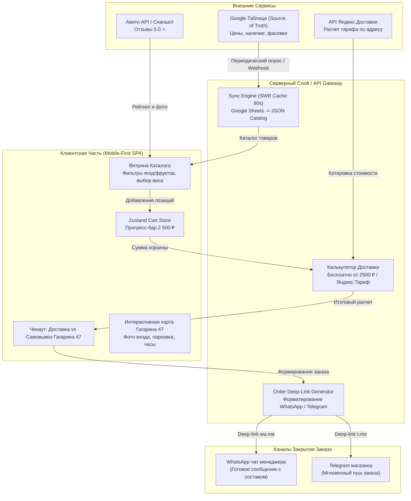
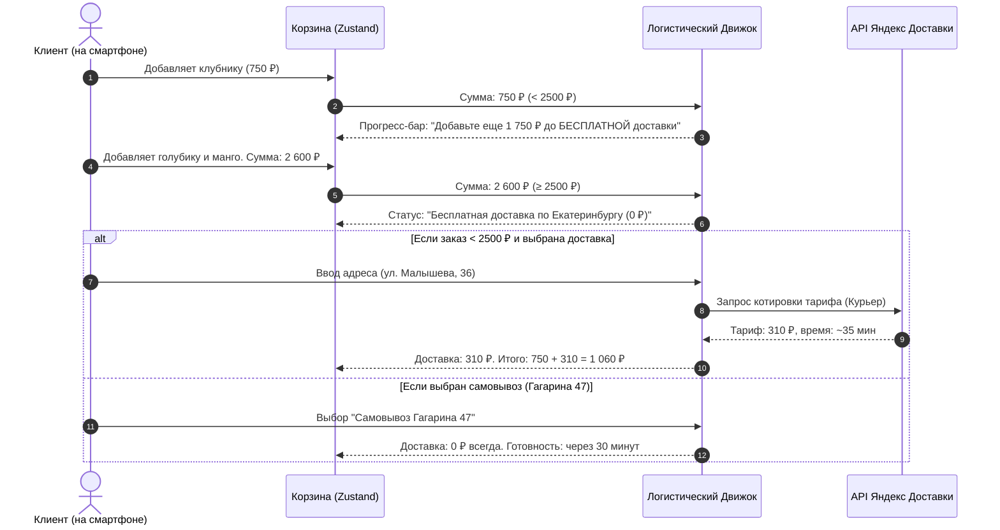

# Архитектурная Спецификация: Интернет-магазин «Вкусно и Ягода» (Екатеринбург)

**Документ:** `specs/architecture.md`  
**Версия:** 1.0.0  
**Автор:** Архитектор Систем и Контрактов (`02_system_architect`)  
**Связанные документы:** [`specs/PRODUCT.md`](file:///Users/main_nikita/Downloads/пространство-проектов/specs/PRODUCT.md), [`src/types/api.ts`](file:///Users/main_nikita/Downloads/пространство-проектов/src/types/api.ts), [`specs/DESIGN.md`](file:///Users/main_nikita/Downloads/пространство-проектов/specs/DESIGN.md)  
**Статус:** Утверждено для реализации

---

## 1. Введение и Архитектурные Принципы

Настоящий документ определяет целевую архитектуру, стек технологий, потоки данных, интеграции и компонентную иерархию интернет-магазина **«Вкусно и Ягода»** (г. Екатеринбург).

### 1.1. Ключевые Архитектурные Постулаты
1. **Google Sheets как Source of Truth (Zero-Overhead CMS):**  
   Каталог ягод, сезонных фруктов, цены и остатки синхронизируются напрямую из Google Таблицы владельца. Чтобы не превышать квоты Google Sheets API и гарантировать мгновенный TTFB (<100ms), на сервере реализовано кэширование по паттерну SWR (Stale-While-Revalidate) с TTL 90 секунд и локальным fallback-снапшотом на случай сбоев сети.
2. **Динамический расчет тарифов Яндекс Доставки:**  
   Для заказов на сумму менее 2 500 ₽ стоимость рассчитывается в реальном времени через шлюз тарифов Яндекс Доставки по координатам адреса в Екатеринбурге. При сумме корзины ≥ 2 500 ₽ расчетная стоимость обнуляется для клиента (`finalClientPrice = 0 ₽`), а магазин покрывает затраты на логистику.
3. **Бесшовный заказ через Мессенджеры (No-Friction Checkout):**  
   Заказ не требует регистрации и создания аккаунтов. Клиент оформляет заказ за 30 секунд. Система кодирует структурированный заказ (состав, граммовка, адрес/самовывоз на Гагарина 47, сумма) в валидный deep-link `wa.me` и `t.me`, моментально переводя покупателя в чат с подтверждением.
4. **Типизированный закон данных ([`src/types/api.ts`](file:///Users/main_nikita/Downloads/пространство-проектов/src/types/api.ts)):**  
   Все объекты валидируются Zod-схемами. Запрещены `any` и неявные типы.

---

## 2. Стек Технологий

| Слой | Технология | Обоснование |
|---|---|---|
| **Клиентский фреймворк** | React 19 + TypeScript 5.7+ | Компонентная модульность, строгая типизация, высокая скорость рендеринга |
| **Сборщик** | Vite 6 | Мгновенный HMR, чистый tree-shaking, сборка WebP/AVIF ассетов |
| **Стилизация** | Tailwind CSS v4 | Система дизайн-токенов «Вкусно и Ягода», поддержка адаптивных сеток |
| **Управление состоянием** | Zustand + LocalStorage Sync | Ультралегкий стейт корзины (менее 1.5 kB), персистентность при перезагрузке страницы |
| **Валидация данных** | Zod 3.25+ | Runtime-валидация строк из Google Таблицы и полей чекаута |
| **Иконки** | Lucide React | Легковесные строгие SVG-иконки с толщиной линии 1.75px |
| **Анимации** | Motion (Framer Motion) | Плавная физика всплывающей корзины, заполнения прогресс-бара и hover-эффектов |
| **Внешние интеграции** | Google Sheets API, Яндекс Доставка API, WhatsApp/Telegram Deep Links | Надежные сервисы без необходимости поддержки сложной БД |

---

## 3. Модульная Архитектура и Потоки Данных

### 3.1. Высокоуровневая диаграмма взаимодействия компонентов



### 3.2. Алгоритм расчета бесплатной доставки и Яндекс Доставки



---

## 4. Компонентная Структура Проекта

```text
src/
├── api/                     # Взаимодействие с API и парсеры
│   ├── googleSheetsClient.ts  # Загрузка и SWR-кэширование каталога
│   ├── yandexDeliveryClient.ts# Котировки тарифов доставки
│   └── messengerLinks.ts      # Генератор deep-links для WhatsApp и Telegram
├── components/              # UI Компоненты (по стандартам Smooth UI & SupaHero)
│   ├── header/              # Floating Header с бейджем Гагарина 47 и корзиной
│   ├── hero/                # SupaHero-секция с сочным визуалом ягод и УТП
│   ├── catalog/             # Сетка товаров, фильтры-таблетки, селектор веса
│   ├── cart/                # Выдвижная корзина (Drawer) с прогресс-баром
│   ├── checkout/            # Форма чекаута (доставка/самовывоз)
│   ├── pickup/              # Схема проезда и фото точки на Гагарина 47
│   ├── reviews/             # Виджет отзывов Авито 5.0 ⭐ с реальными фото
│   └── ui/                  # Атомарные UI компоненты (кнопки, бейджи, инпуты)
├── store/                   # Управление стейтом
│   └── cartStore.ts         # Корзина, персистентность, расчет сумм
├── types/                   # Файлы-законы (Контракты)
│   └── api.ts               # Полная типизация Zod и интерфейсы
└── styles/                  # Дизайн-токены и стили
    └── globals.css          # CSS переменные палитры «Вкусно и Ягода»
```

---

## 5. Безопасность и Нефункциональные Требования

1. **Защита API:**
   * Ключи API Яндекс Доставки и Google Service Account хранятся строго в переменных окружения сервера (`.env.local`) и не попадают в клиентский бандл.
2. **Отказоустойчивость:**
   * При недоступности Google Таблицы клиент мгновенно подтягивает закэшированный snapshot `catalog_cache.json`, предотвращая простой интернет-магазина.
3. **Производительность (Performance Budget):**
   * Бандл первого экрана (First Load JS) < 120 kB gzip.
   * Все изображения товаров оптимизированы под WebP с поддержкой `srcset` для экранов Retina.
