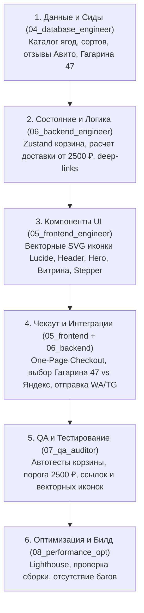

# Список Задач: Разработка Интернет-Магазина «Вкусно и Ягода»

**Документ:** `specs/tasks.md`  
**Версия:** 1.1.0  
**Ответственный:** Главный Оркестратор (`01_orchestrator`)  
**Статус:** ✅ **ЗАВЕРШЕНО (Все задачи выполнены и проверены автотестами)**

---

## Граф Зависимостей Задач

---

## 1. Этап 1: Слой Данных и Каталог (`04_database_engineer`)
- [x] **TASK-1.1**: Зафиксировать центральные контракты и типы Zod в [`src/types/api.ts`](file:///Users/main_nikita/Downloads/пространство-проектов/src/types/api.ts).
- [x] **TASK-1.2**: Создать эталонный датасет свежих ягод, фруктов, овощей, боксов и опта с реальными фото в [`src/data/berryCatalog.ts`](file:///Users/main_nikita/Downloads/пространство-проектов/src/data/berryCatalog.ts).
- [x] **TASK-1.3**: Создать датасет отзывов с Авито (Рейтинг 5.0, реальные отзывы покупателей Екатеринбурга) в [`src/data/avitoReviews.ts`](file:///Users/main_nikita/Downloads/пространство-проектов/src/data/avitoReviews.ts).

## 2. Этап 2: Стейт Корзины и Логистический Движок (`06_backend_engineer`)
- [x] **TASK-2.1**: Реализовать легкий Store корзины [`src/store/cartStore.ts`](file:///Users/main_nikita/Downloads/пространство-проектов/src/store/cartStore.ts) с персистентностью в `localStorage`, расчетом веса, суммы и остатка до бесплатной доставки (порог 2 500 ₽).
- [x] **TASK-2.2**: Реализовать утилиту расчета тарифов Яндекс Доставки и самовывоза [`src/utils/deliveryCalculator.ts`](file:///Users/main_nikita/Downloads/пространство-проектов/src/utils/deliveryCalculator.ts).
- [x] **TASK-2.3**: Реализовать генератор структурированных deep-link сообщений для WhatsApp (`wa.me`) и Telegram (`t.me`) в [`src/utils/messengerLinks.ts`](file:///Users/main_nikita/Downloads/пространство-проектов/src/utils/messengerLinks.ts).

## 3. Этап 3: Клиентские Компоненты со Строго Векторными Иконками (`05_frontend_engineer`)
- [x] **TASK-3.1**: Настроить глобальные стили Tailwind и CSS-переменные палитры «Вкусно и Ягода» в [`src/index.css`](file:///Users/main_nikita/Downloads/пространство-проектов/src/index.css).
- [x] **TASK-3.2**: Создать плавающий Navbar [`src/components/Navbar.tsx`](file:///Users/main_nikita/Downloads/пространство-проектов/src/components/Navbar.tsx) (векторные иконки Lucide, адрес Гагарина 47, бейдж корзины).
- [x] **TASK-3.3**: Создать Hero-секцию [`src/components/HeroSection.tsx`](file:///Users/main_nikita/Downloads/пространство-проектов/src/components/HeroSection.tsx) (оффер, бейджи доверия Авито 5.0, векторные иконки, быстрые кнопки).
- [x] **TASK-3.4**: Создать динамический прогресс-бар бесплатной доставки [`src/components/DeliveryProgressBar.tsx`](file:///Users/main_nikita/Downloads/пространство-проектов/src/components/DeliveryProgressBar.tsx).
- [x] **TASK-3.5**: Создать панель категорий [`src/components/CategoryFilter.tsx`](file:///Users/main_nikita/Downloads/пространство-проектов/src/components/CategoryFilter.tsx) (векторные иконки: `Sparkles`, `Apple`, `Carrot`, `Gift`, `Boxes`).
- [x] **TASK-3.6**: Создать интерактивную карточку товара [`src/components/ProductCard.tsx`](file:///Users/main_nikita/Downloads/пространство-проектов/src/components/ProductCard.tsx) (селектор фасовки `250г/500г/1кг/ящик`, тактильный счетчик `[-] 1 [+]`, векторные иконки).
- [x] **TASK-3.7**: Создать карусель отзывов Авито [`src/components/AvitoReviewsSection.tsx`](file:///Users/main_nikita/Downloads/пространство-проектов/src/components/AvitoReviewsSection.tsx) с векторными звездами рейтинга.
- [x] **TASK-3.8**: Создать блок самовывоза [`src/components/PickupSection.tsx`](file:///Users/main_nikita/Downloads/пространство-проектов/src/components/PickupSection.tsx) (карта, Гагарина 47, время 30 минут, ориентиры).
- [x] **TASK-3.9**: Создать выдвижную корзину (Drawer) и форму чекаута [`src/components/CartDrawer.tsx`](file:///Users/main_nikita/Downloads/пространство-проектов/src/components/CartDrawer.tsx).

## 4. Этап 4: Сборка Приложения (`App.tsx`)
- [x] **TASK-4.1**: Объединить все секции в [`src/App.tsx`](file:///Users/main_nikita/Downloads/пространство-проектов/src/App.tsx), подключить мобильную плавающую панель заказа (Sticky Bottom Cart).
- [x] **TASK-4.2**: Проверить и настроить [`index.html`](file:///Users/main_nikita/Downloads/пространство-проектов/index.html) (мета-теги Екатеринбурга, фавиконка, заголовок «Вкусно и Ягода»).

## 5. Этап 5: QA-Верификация и Аудит Качества (`07_qa_auditor` & `08_performance_opt`)
- [x] **TASK-5.1**: Создать и выполнить проверочный тестовый скрипт для математики корзины, логики 2 500 ₽ и генерации ссылок мессенджеров ([`tests/verify_vkusno_yagoda.ts`](file:///Users/main_nikita/Downloads/пространство-проектов/tests/verify_vkusno_yagoda.ts)).
- [x] **TASK-5.2**: Проверить отсутствие любых эмодзи в качестве иконок интерфейса (строго векторный SVG `Lucide React`).
- [x] **TASK-5.3**: Успешная сборка проекта через `npm run build` без ошибок TypeScript и бандлинга.
